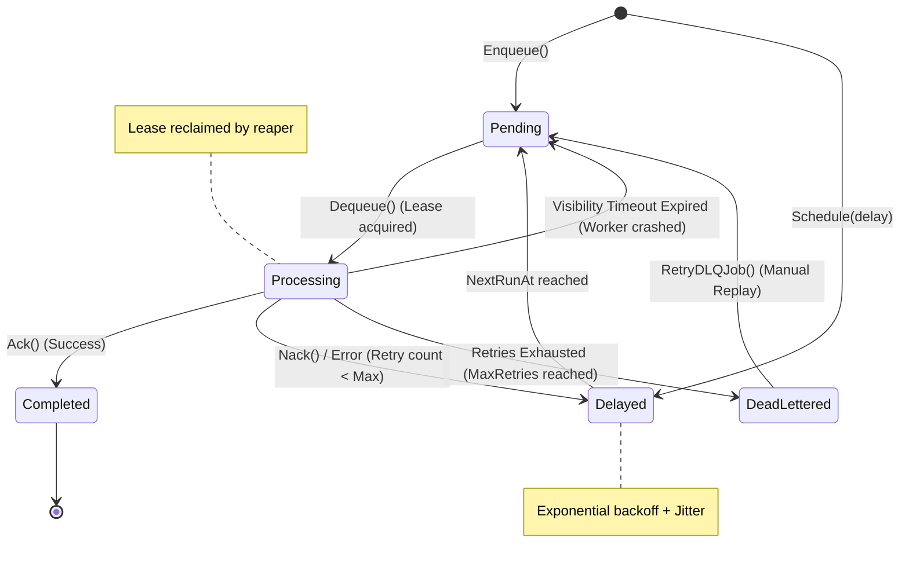

# Distributed Job Queue & Scheduler From Scratch

[](https://github.com/nauman/distributed-job-queue/actions)
[](https://go.dev/)
[](LICENSE)

A resilient, high-concurrency distributed job queue and delayed scheduler built from the ground up in Go without external messaging brokers. Implements **at-least-once delivery**, **visibility timeouts (leases)**, **idempotency deduplication**, **exponential backoff with jitter**, and a **Dead-Letter Queue (DLQ)**.

---

## Job State Machine Lifecycle



---

## Core Engineering Features

1. **At-Least-Once Delivery via Visibility Timeouts**:
   - When a worker leases a job, the job is not deleted; it is rendered invisible to other workers until its `VisibilityDeadline`.
   - If the worker crashes, loses network connectivity, or panics before issuing an `Ack`, a background lease reaper automatically returns the job to `Pending` for redelivery.
2. **Idempotency Deduplication**:
   - Clients supply an optional `idempotency_key`. The engine prevents duplicate execution if an identical task is enqueued concurrently or re-sent across network retries.
3. **Exponential Backoff with Jitter**:
   - Failed jobs are delayed before retrying:
     $$t_{\text{backoff}} = \text{base} \times 2^{\text{retry\_count}} + \text{jitter}$$
   - Prevents the "thundering herd" problem when downstream dependencies fail.
4. **Dead-Letter Queue (DLQ) & Triage**:
   - Poison-pill jobs that repeatedly fail are quarantined in the DLQ with error logs, preserving system throughput while allowing operators to inspect and replay them via REST API.
5. **Heartbeats for Long-Running Tasks**:
   - Active workers periodically issue heartbeats to extend their visibility lease without letting the job time out.

---

## Failure Scenarios & Resilience Analysis

This implementation specifically models and mitigates the primary failure modes of distributed message processing:

| Failure Scenario | Root Cause | System Mitigation |
| :--- | :--- | :--- |
| **Worker Process Crash (SIGKILL / OOM)** | Worker dies mid-execution without sending Ack/Nack. | **Visibility Timeout Expiration**: The job's lease expires; the reaper detects the unacknowledged lease and restores the job to `Pending` within 500ms. |
| **Network Partition / Slow Worker** | Worker is still running but takes longer than estimated. | **Heartbeating / Touch**: Worker goroutines periodically extend `VisibilityDeadline` every half-interval so the job is not erroneously reassigned. |
| **Duplicate Message Dispatch** | Network retry causes client to submit the same payload twice. | **Idempotency Key Cache**: The engine rejects duplicate active/completed keys with HTTP 409 Conflict. |
| **Poison-Pill Job** | Corrupt payload crashes every worker that touches it. | **Dead-Letter Queue (DLQ)**: After `MaxRetries` (default: 3) are exhausted, the job is quarantined into the DLQ, unblocking the queue. |
| **Service Outage Cascades** | Downstream database or 3rd party API goes offline. | **Exponential Backoff with Jitter**: Delay doubles on each failure plus randomized jitter, allowing upstream dependencies time to recover. |
| **Process Termination (SIGTERM)** | Deployment or server reboot occurs while jobs are in flight. | **Graceful Worker Drain**: Pool intercepts OS signals, halts polling, and waits up to 5s for active in-flight handlers to finish cleanly. |

---

## Quickstart (Run in 2 Minutes)

### Option 1: Docker Compose

Launch the Queue Engine:

```bash
docker compose up --build
```

The HTTP management server listens on `http://localhost:8090`.

---

### Option 2: Local Go Setup

1. **Run tests**:
   ```bash
   make test
   ```

2. **Run Queue Server with 4 background workers**:
   ```bash
   make run
   ```

---

## REST API Examples

### 1. Enqueue an Immediate Job with Idempotency
```bash
curl -X POST http://localhost:8090/jobs \
     -H "Content-Type: application/json" \
     -d '{
       "queue": "default",
       "payload": "{\"order_id\": 98231, \"action\": \"charge_card\"}",
       "idempotency_key": "order-charge-98231",
       "max_retries": 3,
       "visibility_timeout_sec": 30
     }'
```

### 2. Schedule a Delayed Job (Runs in 60 Seconds)
```bash
curl -X POST http://localhost:8090/jobs \
     -H "Content-Type: application/json" \
     -d '{
       "queue": "default",
       "payload": "{\"user_id\": 452, \"email_type\": \"welcome_onboarding\"}",
       "delay_seconds": 60
     }'
```

### 3. Inspect Dead-Letter Queue (DLQ)
```bash
curl http://localhost:8090/dlq
```
**Response:**
```json
{
  "dlq_count": 1,
  "jobs": [
    {
      "id": "7a3f81e0bc14",
      "queue": "default",
      "state": "dead_lettered",
      "retry_count": 3,
      "max_retries": 3,
      "last_error": "dial tcp 10.0.1.4:5432: connect: connection refused"
    }
  ]
}
```

### 4. Re-enqueue a Dead-Lettered Job
```bash
curl -X POST http://localhost:8090/dlq/7a3f81e0bc14/retry
```

---

## Project Structure

```
.
├── cmd/
│   └── server/                # HTTP server & worker pool entry point
├── pkg/
│   ├── queue/                 # Job state machine, engine, visibility reaper
│   ├── worker/                # Concurrency pool, heartbeats, graceful drain
│   └── server/                # REST management & producer API
├── Dockerfile                 # Minimal multi-stage container
├── docker-compose.yml         # Container orchestration
├── Makefile                   # Automation targets
└── README.md
```

---

## License
MIT License.
